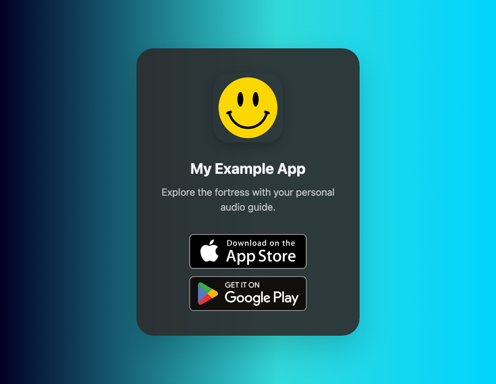

# applink

> One shareable link to all your app market listings: it opens the App Store on iPhones and iPads, Google Play on Android, and a landing page everywhere else.

[](https://github.com/smartcompanion-app/applink/actions/workflows/ci.yml)
[](https://github.com/smartcompanion-app/applink/releases)
[](https://hub.docker.com/r/stefanhuber332/applink)
[](#-quick-start)
[](composer.json)
[](LICENSE)


## ✨ Features

 - 📱 **Automatic device detection**: sends users straight to the right store (Google Play or Apple App Store) based on their device, including iPads that identify as a Mac
 - 🖥️ **Landing page fallback**: desktop browsers and other devices get a clean page with your app icon, title, description and store badges
 - 💬 **Rich link previews**: Open Graph and Twitter Card tags give your link a proper preview in messengers and social media
 - 🗂️ **Many apps, one service**: one YAML file per app, no database, no admin UI
 - 🐳 **Easy deployment**: a single Docker image for `amd64` and `arm64` that runs as non-root and has a health check
 - 🔒 **Secure by default**: strict Content Security Policy, escaped output and validated configuration, with caching headers that keep CDNs from mixing up devices

## 💡 Use cases

 - **Marketing campaigns**: share a single link in emails, social media posts or ads
 - **Print materials**: one QR code for brochures, posters and flyers that works on every phone
 - **In-app recommendations**: let users share your app via messengers with a link that works for their friends, whatever phone they use

## Maintainers

| Maintainer  | GitHub                                      | Social                                                          |
| ----------- | ------------------------------------------- | --------------------------------------------------------------- |
| Stefan Huber | [stefanhuber](https://github.com/stefanhuber) | [Linkedin](https://www.linkedin.com/in/stefan-huber/) |

## 🚀 Quick start

Run the service with the example configuration from this repository:

```shell
git clone https://github.com/smartcompanion-app/applink.git && cd applink
docker run --rm -p 9080:80 -v "$(pwd)/docs/example_storage:/applink/storage:ro" ghcr.io/smartcompanion-app/applink
```

Open [http://localhost:9080/myapp](http://localhost:9080/myapp). A desktop browser shows the landing page; a phone is redirected to its app store.



The image is published to both registries, so use whichever you prefer:

| Registry | Image |
| --- | --- |
| GitHub Container Registry | `ghcr.io/smartcompanion-app/applink` |
| Docker Hub | `stefanhuber332/applink` |

Tags follow the release version: `0.2.0` (exact), `0.2` (latest patch) and `latest`.

### Docker Compose

```yaml
services:
  applink:
    image: ghcr.io/smartcompanion-app/applink:0.2
    ports:
      - "9080:80"
    volumes:
      - ./storage:/applink/storage:ro
    restart: unless-stopped
```

## Configuration

All configuration lives in a storage directory that is mounted into the container at `/applink/storage`:

```
storage/
├── configuration/
│   ├── myapp.yml        → https://applink.example.com/myapp
│   └── otherapp.yml     → https://applink.example.com/otherapp
└── icons/
    ├── myapp.png        → https://applink.example.com/icons/myapp.png
    └── otherapp.png
```

Each `.yml` file in `configuration/` is one app, and its filename is the path of the link. Identifiers may contain letters, digits, `-` and `_`. The query form `https://applink.example.com/?app=myapp` works too. Images in `icons/` are served as they are. Changes take effect immediately, without a restart.

### Example

A full example is available in [`docs/example_storage`](docs/example_storage):

```yaml
links:
  ios: https://apps.apple.com/de/app/festung-kufstein/id1090047406?platform=iphone
  android: https://play.google.com/store/apps/details?id=at.beyondit.audioguide
page:
  base-url: http://localhost:9080
  title: My Example App
  description: Explore the fortress with your personal audio guide.
  background-color: 'linear-gradient(90deg, rgba(2,0,36,1) 0%, rgba(50,217,218,1) 56%, rgba(0,212,255,1) 100%)'
  app-icon: example_icon.png
```

### Options

| Option | Required | Description |
| --- | --- | --- |
| `links.ios` | one of both | App Store link. iPhones, iPads and iPods are redirected here. |
| `links.android` | one of both | Google Play link. Android devices are redirected here. |
| `page.title` | yes | App name, shown on the landing page and in link previews. |
| `page.description` | no | Short description for the landing page, search engines and link previews. |
| `page.app-icon` | no | Filename of the icon in `icons/`, used on the landing page, as favicon and as preview image. |
| `page.background-color` | no | Any CSS `background` value: a color, gradient or image. |
| `page.base-url` | no | Public URL of the service, e.g. `https://applink.example.com`. Link previews need absolute URLs, so set it if requests do not reach applink with the public host name. Without it, the URL is derived from the request (`Host` and `X-Forwarded-Proto`). |

Links have to be absolute `https`, `http`, `itms-apps` or `market` URLs. An invalid configuration is reported in the container log, and the link responds with an error page instead of a broken one.

### Environment variables

| Variable | Default | Description |
| --- | --- | --- |
| `APPLINK_STORAGE` | `/applink/storage` | Path of the storage directory inside the container. |

## How it works

| Request | Response |
| --- | --- |
| iPhone, iPad (iOS ≤ 12) or iPod with an `ios` link | `302` redirect to the App Store |
| Android device with an `android` link | `302` redirect to Google Play |
| iPad on iPadOS 13+ | Landing page, which forwards to the App Store with JavaScript, since these iPads identify as a Mac and can only be detected by their touch screen |
| Anything else, or no link for the platform | `200` landing page with store badges |
| Unknown app | `404` error page |
| Invalid configuration | `500` error page, details in the container log |
| `/healthz` | `200 ok`, used by the Docker health check |

## Deployment

applink serves plain HTTP on port 80 and expects a reverse proxy or load balancer in front of it for TLS, for example Traefik, Caddy, nginx or a cloud load balancer. Forward the `Host` header and set `X-Forwarded-Proto`, or set `page.base-url` per app.

App responses send `Vary: User-Agent` and `Cache-Control: no-store`. If you put a CDN in front of applink, keep those headers intact. Otherwise the CDN may send every visitor to the store of whoever opened the link first.

## Development

Requires PHP 8.4+ and Composer:

```shell
composer install
composer serve    # http://localhost:8080/myapp with docs/example_storage
composer check    # code style, PHPStan and tests
```

See [CONTRIBUTING.md](CONTRIBUTING.md) for the project layout, testing and the release process.

## License

[BSD 2-Clause](LICENSE) © SmartCompanion
